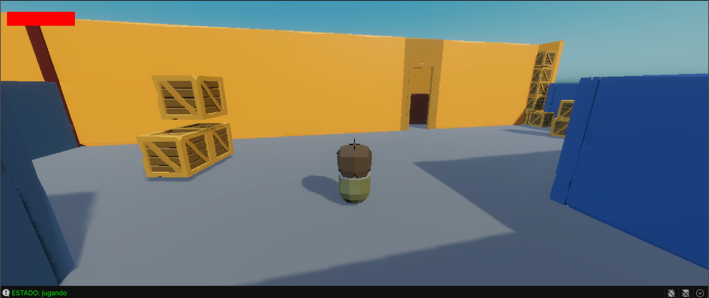
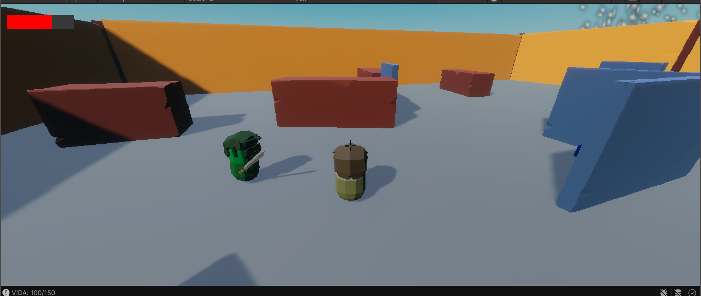
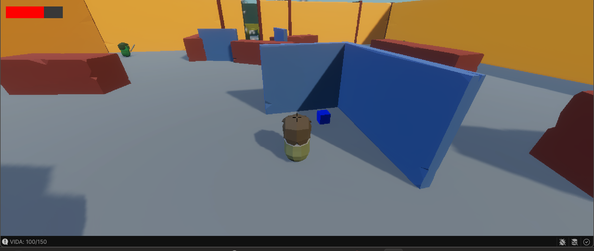
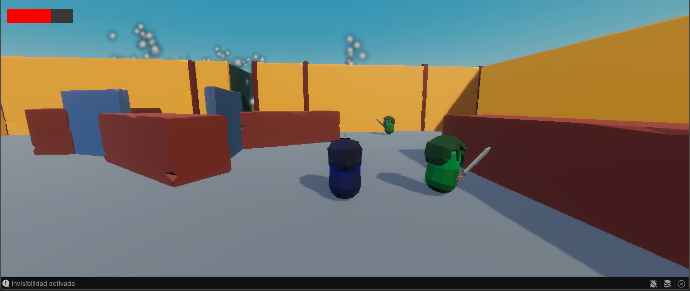
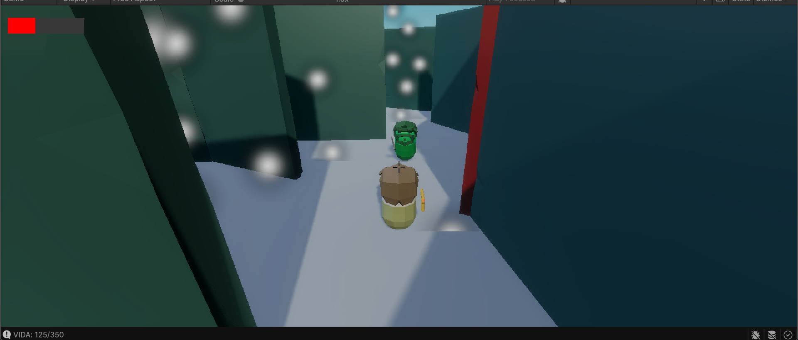
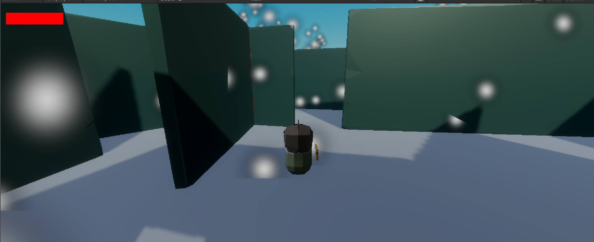
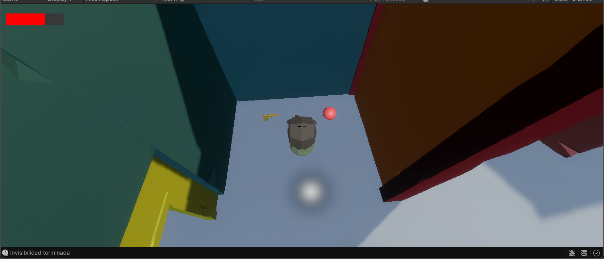
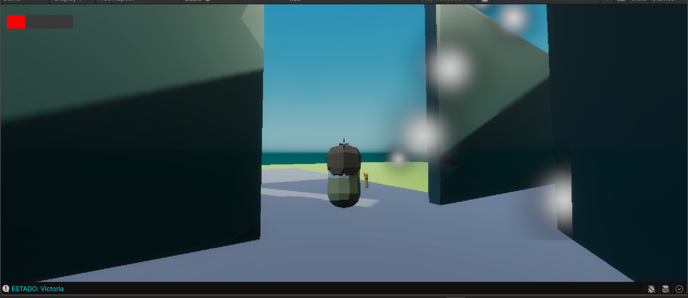
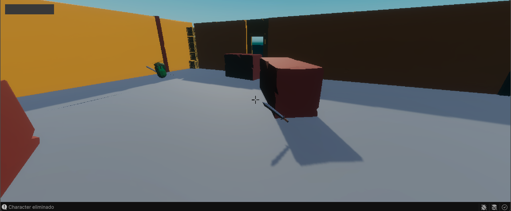

# Zombies Escape: sobrevive o muere
> Asignatura: Programación de Videojuegos I 
Carrera: Tecnicatura Universitaria en Diseño Integral de Videojuegos (TUDIVJ) — UNJu 
Trabajo Práctico N° 2: Integración de mecánicas 3D por Raycast, sistemas de navegación de enemigos con NavMesh, terrenos, gestión de salud/puntuación y control centralizado de juego 
Estudiante: Tolaba Tiago Leonardo Misael 
LU: TUV000834
Equipo Docente: Mg. Ing. Ariel Alejandro Vega | Tecn. Kevin Alexis Roman Llampa

___
## 🛠️ Version de Unity

> Unity: Unity 6.3 LTS
Proyecto: 3D
Lenguaje: C#
___

## 🎮 Descripcion del Proyecto
Zombie Escpae: Sobrevivir o morir: es un videojuego de sigilio y ocultarse en obstaculos.
El jugador debera pasar diversos obstaculos para poder pasar el nivel superando peligrosas trampas y a los zombies
___
## 🕹️ Controles del Jugador
| Accion | Tecla/Boton | Descripcion|
|-----|-----------|--------|
| **Movimiento** | `W` , `A` , `S` , `D` / `Flechas` | Mueve al personaje por el escenario |
| **Saltar** | `ESPACIO` | Saltar entre plataformas |
| **Interactuar** | `E` / Contacto con zona (`Trigger`) | Dispara el arma, interactua con objetos y recolecta |
| **Disparar** | `click izquierdo del raton` | Dispara rayos para eliminar enemigos |
| **Pausar** | `ESC` | Permite pausar o reanudar la partida |
|
___
## ⚙️ Mecanicas
- **Infiltracion y exploracion**
El escenario es un terreno llano de pasto, en medio de esa llanura hay una base donde esperan zombies hambrientos para comerte. 

- **Enemigos con NavMesh**
Los guardias utilizan NavMeshAgent para desplazarse y perseguir al jugador
Estados del enemigo:
  - Patrulla: recorren puntos establecidos en el escenario
  - Persecucion: detectan al jugador y se desplazan hacia su posicion
  - Ataque: se acercan al jugador y le ocasionan daño cuando se encuentra dentro del alcance
  - Aturdimiento: pueden quedar temporalmente inmovilizados mediante el aturdidor que posee el jugador

- **Interaccion y salto con Raycast**
El jugador utiliza un Raycast para detectar objetos y elementos interactivos que se encuentran delante de él
Al presionar E, puede interactuar con los objetos detectados, recolectar fragmentos de informacion, utilizar consolas y activar el aturdidor cuando apunta a un guardia, se utiliza el sistema de capas (`LayerMask`) para determinar que elementos pueden ser detectados por el Raycast

  Ademas tambien se utiliza para el salto del jugador, utilizando el sistema de capas (`groundLayer`)

- **Arma**
El jugador cuenta con armas para enfrentarse a los guardias:
  - Arma (`Click izquierdo del raton`): dispara proyectiles capaces de causar daño a los enemigos

  Estas mecanicas permiten elegir cómo afrontar los encuentros durante la infiltracion

- **Sistema de salud y puntos**
El jugador dispone de una cantidad de 150 de vida. Los ataques de los zombies y las trampas quitan daño al jugador. Si la salud llega a cero, se activa el estado de derrota

  Los zombies, tambien tienen un sistema de vida y el cual puede ser derrotado con el arma del jugador
  
 Gana 100 puntos al matar a los zombies . 

- **Requisitos Opcionales**
En mi caso, yo utilize 3 de los requisitos opcionales:
  - Opcion A (Arma por Raycast): Un arma de disparo (cambie el aturdie¿miento solo para que mate a los zombies) que proyecte un Raycast frontal para matar al enemigo por unos segundos
  - Opcion B (Power up de invisibilidad): Un power up que te hace invisible por 15 segundos haciendote indectectable para loz zombies
  - Opcion F (Zona de Gas Toxico): Area de peligro donde se descuente vida al jugador paulatinamente mientras permanezca dentro de la zona

- **Estados del Juego**
  - Playing: Estado jugando del juego
  - Paused: Estado de pausa, con `p` pausa el juego y muestra el progreso del juego. Al presionar nuevamente `p` vuelve al estado de jugando
  - Victory: Se alcanza al poder escapar del lugar. 
  - Defeat: Se produce cuando el jugador pierde toda su salud
___
## 📝 Explicacion Tecnica de Codigo:
1. ### Deteccion e Interaccion por Raycast + LayerMask
Script principal: ```PlayerMovement.cs``` y ```PlayerInteraction.cs```
Funcionamiento: Ambos script utilizan el Raycast, y filtra con LayerMask, para controlar el salto y la interaccion con distintos objetos en el escenario

### PlayerMovement.cs
```csharp
void Update()
{
    // Movimiento
    h = Input.GetAxis("Horizontal");
    v = Input.GetAxis("Vertical");
    dir = new Vector3(h, 0, v);

    // Salto
    CheckGround();

    if (Input.GetButtonDown("Jump") && isGrounded)
    {
        rb.AddForce(Vector3.up * jumpForce, ForceMode.Impulse);
    }
}

private void CheckGround()
{
    // Raycast
    Vector3 origin = transform.position; // Origen del Rayo

    // Lanza el rayo
    isGrounded = Physics.Raycast(origin, Vector3.down, rayDistance, groundLayer);

    // Dibujar el raycast (Test)
    Color ColorRay = isGrounded ? Color.green : Color.red;
    Debug.DrawRay(origin, Vector3.down * rayDistance, ColorRay);
}


### PickItem.cs
```csharp
public class PickItem : MonoBehaviour
{
    [Header("Referencia a la mano del jugador")]
    [SerializeField] private Transform hand;

    private GameObject currentItem = null;

    private void OnTriggerStay(Collider other)
    {
        // Detecta objetos con la etiqueta Item
        if (other.CompareTag("Item") && currentItem == null)
        {
            // Recoge el objeto al presionar E
            if (Input.GetKeyDown(KeyCode.E))
            {
                Pick(other.gameObject);
            }
        }
    }

    private void Pick(GameObject item)
    {
        currentItem = item;

        // Equipa el objeto en la mano del jugador
        item.transform.SetParent(hand);
        item.transform.localPosition = Vector3.zero;
        item.transform.localRotation = Quaternion.identity;

        // Desactiva las físicas del objeto
        Rigidbody rb = item.GetComponent<Rigidbody>();
        if (rb != null)
        {
            rb.isKinematic = true;
            rb.linearVelocity = Vector3.zero;
        }

        // Desactiva el collider para evitar colisiones
        Collider col = item.GetComponent<Collider>();
        if (col != null)
        {
            col.enabled = false;
        }

        // Activa el sistema de disparo si el objeto es un arma
        GunController gun = item.GetComponent<GunController>();
        if (gun != null)
        {
            gun.enabled = true;
        }

        Debug.Log("Arma recogida: " + item.name);
    }

    public bool HasItem()
    {
        return currentItem != null;
    }
}
```

2. ### Navegacion e Inteligencia Artificial con NavMesh
Script principal: ```EnemyAI.cs```
Funcionamiento: Maneja los estados del enemigo, patrulla, persecucion y ataque

### EnemyAI.cs
```csharp
     using System.Collections;
using System.Collections.Generic;
using UnityEngine;
using UnityEngine.AI;

public class EnemyAI : MonoBehaviour
{
    public enum AIState { Patrol, Chase, Attack }

    [Header("States")]
    [SerializeField] private AIState currentState = AIState.Patrol;

    [Header("Detect Settings")]
    [SerializeField] private float detectionRadius = 8f;
    [SerializeField] private float attackRadius = 2f;

    [Header("Patrol Settings")]
    [SerializeField] private Transform[] patrolPoints;
    [SerializeField] private float waitTimeAtPoint = 3f;
    private int currentPatrolIndex;
    private bool isWaitingAtPoint;

    [Header("Attack Settings")]
    [SerializeField] private float attackCooldown = 1.5f;
    private bool isAttacking = false;

    private NavMeshAgent agent;
    private Transform playerTransform;
    private HealthSystem healthSystemPlayer;
    private Attack attack;
    //Power up de inivicibilidad
    private PlayerMovement playerMovement;

    private bool isStunned;

    private void Awake()
    {
        agent = GetComponent<NavMeshAgent>();
        attack = GetComponent<Attack>();

    }

    private void Start()
    {
        GameObject playerObj = GameObject.FindGameObjectWithTag("Player");
        if (playerObj != null)
        { 
            healthSystemPlayer = playerObj.GetComponent<HealthSystem>();
            playerTransform = playerObj.transform;

            //  Obtiene el componente de invisibilidad del jugador
            playerMovement = playerObj.GetComponent<PlayerMovement>();
        }
        else
        {
            Debug.LogError(" No  hay GameObjects con  tag Player");
        }

        if (patrolPoints.Length > 0)
        {
            GoToNextPatrolPoint();
        }
    }

    private void Update()
    {
        if (isStunned || playerTransform == null || (healthSystemPlayer != null && healthSystemPlayer.IsDead))
        {
            agent.isStopped = true;
            return;
        }

        // POWER UP DE INVISIBILIDAD
        // Si el jugador está invisible, el enemigo no lo detecta y vuelve a patrullar.
        if (playerMovement != null && playerMovement.IsInvisible)
        {
            // Si el enemigo no está patrullando,vuelve al estado de patrulla.

            if (playerMovement != null && playerMovement.IsInvisible)
            {
                currentState = AIState.Patrol;
            }
        }

        float distanceToPlayer = Vector3.Distance(transform.position, playerTransform.position);

        switch (currentState)
        {
            case AIState.Patrol:
                UpdatePatrolState(distanceToPlayer);
                break;

            case AIState.Chase:
                UpdateChaseState(distanceToPlayer);
                break;

            case AIState.Attack:
                UpdateAttackState(distanceToPlayer);
                break;
        }
    }

    private void UpdatePatrolState(float distanceToPlayer)
    {
        agent.isStopped = false;

        if (playerMovement == null || !playerMovement.IsInvisible)
        {
            if (distanceToPlayer <= detectionRadius)
            {
                currentState = AIState.Chase;
                return;
            }
        }

        if (!agent.pathPending &&
            agent.remainingDistance <= agent.stoppingDistance)
        {
            if (!isWaitingAtPoint)
            {
                StartCoroutine(WaitAndMoveToNextPoint());
            }
        }
    }

    private void UpdateChaseState(float distanceToPlayer)
    {
        agent.isStopped = false;
        agent.SetDestination(playerTransform.position);

        // Transicion  Ataque
        if (distanceToPlayer <= attackRadius)
        {
            currentState = AIState.Attack;
            return;
        }

        // Si el jugador se escapa del radio de deteccion, vuelve a patrullar
        if (distanceToPlayer > detectionRadius * 1.2f)
        {
            currentState = AIState.Patrol;
            GoToNextPatrolPoint();
        }
    }

    private void UpdateAttackState(float distanceToPlayer)
    {

        transform.LookAt(new Vector3(playerTransform.position.x, transform.position.y, playerTransform.position.z));
        // Transicion de regreso a Persecucion si se aleja

        if (distanceToPlayer > attackRadius && !isAttacking)
        {
            currentState = AIState.Chase;
            return;
        }
        if (!isAttacking)
        {
            StartCoroutine(AttackCooldown());
        }

    }

    IEnumerator AttackCooldown()
    {
        isAttacking = true;
        agent.isStopped = true;
        ExecuteAttack();
        yield return new WaitForSeconds(attackCooldown);
        isAttacking = false;
        agent.isStopped = false;


    }

    private void ExecuteAttack()
    {
        if (healthSystemPlayer != null)
        {
            Debug.Log("Ataque  contra el jugador");
            attack.Melee();
        }
    }

    private IEnumerator WaitAndMoveToNextPoint()
    {
        isWaitingAtPoint = true;
        yield return new WaitForSeconds(waitTimeAtPoint);

        if (patrolPoints.Length > 0)
        {
            currentPatrolIndex = (currentPatrolIndex + 1) % patrolPoints.Length;//2%3
            GoToNextPatrolPoint();
        }

        isWaitingAtPoint = false;
    }

    private void GoToNextPatrolPoint()
    {
        if (patrolPoints.Length == 0) return;

        agent.SetDestination(patrolPoints[currentPatrolIndex].position);
    }
    private void OnDrawGizmosSelected()
    {
        // Radio de deteccion (Amarillo)
        Gizmos.color = Color.yellow;
        Gizmos.DrawWireSphere(transform.position, detectionRadius);

        // Radio de ataque (Rojo)
        Gizmos.color = Color.red;
        Gizmos.DrawWireSphere(transform.position, attackRadius);
    }


    public void Stun(float duration)
    {
        StartCoroutine(StunRoutine(duration));
    }

    private IEnumerator StunRoutine(float duration)
    {
        isStunned = true;
        agent.isStopped = true;
        Debug.Log($"Aturdido por {duration} segundos");

        yield return new WaitForSeconds(duration);

        isStunned = false;
        agent.isStopped = false;
        Debug.Log("Recuperado del aturdimiento");
    }
}
```

3. ### Sistema de Salud, Daño y Puntuacion
Script principal: ```HealthSystem.cs``` y ```GameManager.cs```
Funcionamiento: Se encargan del daño al jugador y al guardia, la recoleccion de puntos y enseña por consola

### HealthSystem.cs
```csharp
     public void TakeDamage(float amount)
    {
        IEnumerator DamageFlash()
        {
            mesh.enabled = false;

            yield return new WaitForSeconds(0.1f);

            mesh.enabled = true;

            yield return new WaitForSeconds(0.1f);

            mesh.enabled = false;

            yield return new WaitForSeconds(0.1f);

            mesh.enabled = true;
        }


        if (isDead) return;
        currentHealth -= amount;
        //clamp permite normalizar un valor de acuerdo a los limites
        currentHealth = Mathf.Clamp(currentHealth, 0f, maxHealth);

       

        //Debug.Log($"Salud actual: " + currentHealth);
        Debug.Log($"VIDA: {currentHealth}/{maxHealth}");

        if (flashCoroutine != null)
        {
            StopCoroutine(flashCoroutine);
        }

        flashCoroutine = StartCoroutine(DamageFlash());

        if (currentHealth <= 0f)
        {
            Dead();
        }
    }


   private void Dead()
    {
        Debug.Log("ENTRO A DEAD");

        isDead = true;

        Destroy(gameObject);
    
        //agregar condicional comparando tags player y character, notificar al gameManager

        if (gameObject.CompareTag("Player"))
        {
            GameManager.Instance.NotifyPlayerDead();
        }
        else if (gameObject.CompareTag("Character"))
        {
            GameManager.Instance.NotifyEnemyDefeat();
        }
    }
```

5. ### GameManager.cs
 controla el estado del juego 
```csharp


public enum GameState
{
    Start,
    Playing,
    Paused,
    Victory,
    GameOver,
}
public class GameManager : MonoBehaviour
{
  

    //singleton
    private void Awake()
    {
        if (Instance == null)
        {
            Instance = this;
        }
        else
        {
            Destroy(gameObject);
        }
        DontDestroyOnLoad(gameObject);//UI y escenas
    }

        //estados iniciales
        //EnemyAI[] enemies = FindObjectsByType<EnemyAI>(FindObjectsSortMode.None);
     void Start()
    {
        // Busca automáticamente todos los enemigos de la escena
        enemies = FindObjectsByType<EnemyAI>(FindObjectsSortMode.None);

        totalEnemies = enemies.Length;
        enemiesRemaining = totalEnemies;

        score = 0;

        Debug.Log($"Enemigos encontrados: {totalEnemies}");
        Debug.Log($"PUNTAJE: {score}");

        ChangeState(GameState.Playing);
    }
    void Update()
    {
        //pausa inputs
        if (Input.GetKeyDown(KeyCode.P))
        {
            Paused();
        }
    }


    //switch estados
    public void ChangeState(GameState newState)
    {
        currentState = newState;
        switch (currentState)
        {
            case GameState.Start:
                Time.timeScale = 1f;//0f - 1f
                Debug.Log("Inicio el juego");
                break;
            case GameState.Playing:
                Time.timeScale = 1f;
                Debug.Log("<color=green>ESTADO: jugando</color>");
                break;
            case GameState.Paused:
                Time.timeScale = 0f;
                Debug.Log("<color=yellow>ESTADO: pausa</color>");
                break;
            case GameState.Victory:
                Time.timeScale = 0f;
                //corrutina para detener el tiempo
                Debug.Log("<color=cyan>ESTADO: Victoria</color>");
                break;
            case GameState.GameOver:
                Time.timeScale = 0f;
                Debug.Log("<color=red>ESTADO: Game Over</color>");
                break;
        }
    }

    //pausa
    public void Paused()
    {
        if (currentState == GameState.Playing)
        {
            ChangeState(GameState.Paused);
        }
        else if (currentState == GameState.Paused)
        {
            ChangeState(GameState.Playing);
        }
    }

    public void AddScore(int points)
    {
        score += points;

        Debug.Log($"<color=yellow>PUNTAJE: {score}</color>");
    }

    //notificaciones
    public void NotifyPlayerDead()
    {
        if (currentState != GameState.Playing) return;

        ChangeState(GameState.GameOver);
    }

    public void NotifyEnemyDefeat()
    {
        if (currentState != GameState.Playing) return;

        enemiesRemaining--;

        score += 100;

        Debug.Log($"PUNTAJE ACTUAL: {score}");
        Debug.Log($"Enemigos restantes: {enemiesRemaining}");
    }

    public void NotifyGoalZone()
    {
        if (currentState != GameState.Playing) return;

        ChangeState(GameState.Victory);
    }

}
```


6. ### Requisitos Opcionales 
Script principal: ```ToxicGas.cs```, ```GunController```, ```GasMask```
 y ```PowerUpInvisibility```

### GunController.cs
```csharp

public class GunController : MonoBehaviour
{
    private void Start()
    {
        currentAmmo = maxAmmo;
        enabled = false;
    }


    private void Update()
    {
        if (Input.GetMouseButtonDown(0))
        {
            Shoot();
        }
    }

    private void OnDrawGizmos()
    {
        if (playerCamera == null)
            return;

        Gizmos.color = Color.red;

        Ray ray = playerCamera.ScreenPointToRay(
            new Vector3(Screen.width / 2f, Screen.height / 2f)
        );

        Gizmos.DrawRay(ray.origin, ray.direction * range);
    }

    private void Shoot()
    {
        if (currentAmmo <= 0)
        {
            Debug.Log("Sin munición");
            return;
        }

        currentAmmo--;

        Debug.Log($"Disparo realizado. Balas restantes: {currentAmmo}");

        Ray ray = playerCamera.ScreenPointToRay(
            new Vector3(Screen.width / 2f, Screen.height / 2f)
        );

        RaycastHit hit;

        if (Physics.Raycast(ray, out hit, range))
        {
            Debug.Log("Impactó en: " + hit.collider.name);

            HealthSystem targetHealth =
                hit.collider.GetComponent<HealthSystem>();

            if (targetHealth != null)
            {
                targetHealth.TakeDamage(damage);
            }
        }
    }

    public int GetAmmo()
    {
        return currentAmmo;
    }
    
}
```

### PowerUpInvisibility.cs
```csharp
    private void OnTriggerEnter(Collider other)
    {
        if (other.CompareTag("Player"))
        {
            PlayerMovement player =
                other.GetComponent<PlayerMovement>();

            if (player != null)
            {
                player.ActivarInvisibilidad(duracion);
            }

            Destroy(gameObject);
        }
    }

```

### GasMask.cs
```csharp

```
### ToxicGas.cs
```csharp
    private void OnTriggerStay(Collider other)
    {
        if (!other.gameObject.CompareTag("Player")) return;
        health = other.gameObject.GetComponent<HealthSystem>();
        if (health == null) return;

        timer += Time.deltaTime;
        if (timer >= damageInterval)
        {
            health.TakeDamage(damage);
            timer = 0f;
        }
        foreach (var g in gas)
        {
            g.Play();
        }
    }

    private void OnTriggerExit(Collider other)
    {
        if (!other.gameObject.CompareTag("Player")) return;
        health = null;
        timer = 0f;
        foreach (var g in gas)
        {
            g.Stop();
        }
    }
```
___

## 📸 Capturas de Pantalla
### inicio


### Zona 1





### Zona 2



### Victoria


___

## ▶️ Como abrir y ejecutar el proyecto

1. Descargar o clonar el repositorio desde GitHub.
2. Abrir Unity Hub.
3. Seleccionar **Add project from disk** y elegir la carpeta del proyecto
4. Abrir el proyecto utilizando **Unity 6.3 LTS**
5. Abrir la escena principal ubicada en `Assets/Scenes/`
6. Presionar **Play** para ejecutar el juego
7. Utilizar los controles indicados en la seccion **Controles del Jugador**
___
## 📚 Bibliografia
- [README.md - Markdown](https://markdown.es)
- [Material de clase — Programacion de Videojuegos I](https://virtual.unju.edu.ar/course/view.php?id=2520)
- [Material dado por el profesor Kevin Alexis Roman Llampa](https://github.com/Kivito3d/TP2_PVJ1_2026)
- Apuntes y ejemplos dados durante las clases de Programacion de Videojuegos I

## Descripción

Trabajo Práctico desarrollado en Unity para la materia Programación de Videojuegos.

El objetivo del juego es controlar a un personaje capaz de explorar el nivel, combatir enemigos, recoger armas y power-ups, atravesar zonas peligrosas y alcanzar la meta para completar la partida.

---

## Mecánicas Implementadas

### Movimiento del Jugador

- Movimiento utilizando Rigidbody.
- Salto.
- Rotación del personaje.
- Detección de suelo mediante Raycast.

### Sistema de Vida

- Vida máxima configurable.
- Recepción de daño.
- Curación mediante power-ups.
- Barra de vida visual.
- Indicador numérico de vida.
- Muerte del jugador al llegar a 0 HP.

### Sistema de Combate

#### Enemigos

Los enemigos utilizan una Máquina de Estados Finita (FSM) compuesta por:

- Patrol
- Chase
- Attack

Comportamiento:

- Patrullan entre puntos establecidos.
- Detectan al jugador dentro de un radio determinado.
- Persiguen al jugador.
- Lo atacan cuando entra en rango.

#### Armas

- Recogida mediante interacción con la tecla **E**.
- Equipamiento automático en la mano del jugador.
- Sistema de disparo mediante **Raycast**.
- Munición limitada.
- Daño a enemigos.

### Sistema de Puntaje

- Cada enemigo derrotado otorga **100 puntos**.
- El puntaje es gestionado por el GameManager.
- Se informa por consola durante la partida.

---

## Power-Ups

### Invisibilidad

Permite al jugador volverse invisible temporalmente.

Características:

- Los enemigos dejan de detectarlo.
- Los enemigos continúan patrullando normalmente.
- Tiene una duración limitada.

### Máscara de Gas

Power-up especial para sobrevivir en zonas contaminadas.

Características:

- Incrementa temporalmente la vida máxima.
- Recupera la vida perdida.
- Facilita atravesar zonas de gas tóxico.

---

## Zona de Gas Tóxico

El juego incorpora áreas peligrosas que dañan al jugador.

Características:

- Daño periódico.
- Área definida mediante Trigger.
- Representación visual mediante partículas.

---

## Sistema de Estados

El GameManager administra los siguientes estados:

- Playing
- Paused
- Victory
- GameOver

Funciones:

- Control del flujo general del juego.
- Gestión de pausas.
- Control de victoria y derrota.
- Control de puntaje.
- Notificación de eventos por consola.

---

## Condición de Victoria

La partida finaliza cuando el jugador alcanza la zona objetivo del nivel.

---

## Tecnologías Utilizadas

- Unity
- C#
- Rigidbody Physics
- NavMeshAgent
- Raycast
- Particle System
- Canvas UI
- TextMeshPro

---

## Controles

| Acción | Tecla |
|----------|----------|
| Moverse | WASD |
| Saltar | Espacio |
| Recoger arma/objeto | E |
| Disparar | Click Izquierdo |
| Pausa | P |

---

## Autor

**Tiago Tolaba**

Tecnicatura Universitaria en Desarrollo Integral de Videojuegos

Programación de Videojuegos I

2026